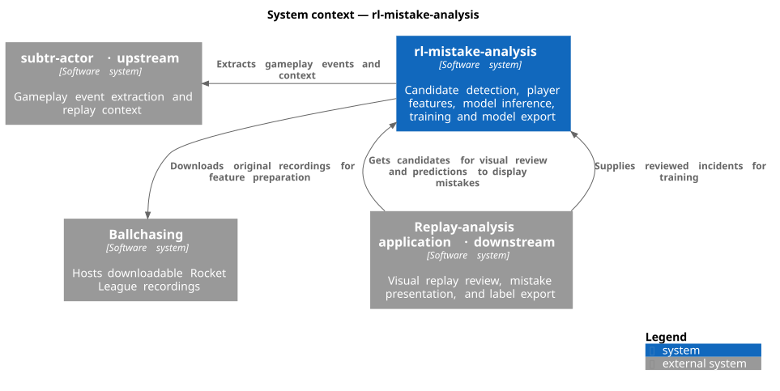
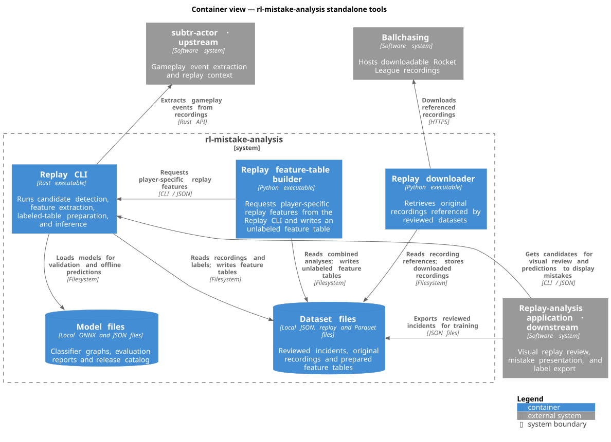

# rl-mistake-analysis

rl-mistake-analysis helps replay-analysis applications identify potential player mistakes in Rocket League and score them with trained models. It also turns human-reviewed incidents into training data, using the same feature calculations that supply the models during inference.

Model releases and evaluation results are available on [Hugging Face](https://huggingface.co/alina-afanaseva/rl-mistake-analysis-models).

A **candidate** is an incident worth reviewing. **Features** are measurements describing that incident. A **model** uses those measurements to estimate whether the incident is a mistake. Each mistake kind defines its candidates and features; different kinds can use different models.

[subtr-actor](https://github.com/rlrml/subtr-actor) supplies gameplay events and replay context. Downstream applications display incidents, collect reviews, and use predictions. Implemented mistake kinds: `bumping_teammate`.

## Architecture

The context view shows this project and the systems it interacts with. Downstream applications obtain candidates for visual review, use models to present mistakes, and export reviewed datasets for training. This project extracts gameplay events through subtr-actor, prepares labeled feature tables, evaluates models, and exports selected models.



The container view shows a CLI integration. A downstream application invokes the Rust CLI to obtain candidates and predictions. The Python feature-table builder requests player-specific features from the CLI and writes unlabeled Parquet tables. The label adapter joins reviewed incidents to their player-specific feature rows. Training tools evaluate configured models, select a winner by cross-validation, and verify exported ONNX probabilities. The downloader retrieves recordings referenced by reviewed datasets. Rust applications can also import the candidate and inference libraries directly.



## Get started

| What you want | Use |
| --- | --- |
| Unlabeled incidents for review | [Candidate library](#get-unlabeled-candidates) |
| Mistake probabilities from a trained model | [Inference library](#score-candidates-with-a-model) |
| Train with your own labels | [Training tools](#prepare-data-for-training) |
| Process replay files without integrating a library | [Command-line tool](#process-replay-files-from-the-terminal) |

### Get unlabeled candidates

In your Rust application's directory, add the candidate library from GitHub:

```sh
cargo add rl-mistake-analysis-candidates --git https://github.com/assembledev/rl-mistake-analysis.git
```

Cargo fetches and builds the package, recording the source commit in your application's lockfile. Rust 1.92+ is required. You can select a release with `--tag RELEASE_TAG` or a commit with `--rev COMMIT`.

Pass extracted replay events to the library and select a mistake kind:

```rust
use rl_mistake_analysis_candidates::MistakeKind;

let candidates = MistakeKind::BumpingTeammate.candidates(&replay_events)?;
```

`replay_events` contains the supplier's events and recording identity, following [the input contract](docs/formats.md#replay-events). The result contains candidate incidents, their evidence, and features. Labels are supplied by human review.

### Score candidates with a model

Add the inference library to the same application:

```sh
cargo add rl-mistake-analysis-inference --git https://github.com/assembledev/rl-mistake-analysis.git
```

Install CPU ONNX Runtime 1.24+. Before building, set `ORT_LIB_PATH` to its library directory and `ORT_PREFER_DYNAMIC_LINK=1`. The runtime library must also be available to the operating system's dynamic loader when executing inference.

Download a compatible model release and its `manifest.json` catalog into a local model directory. Load the selected kind and version, then score candidates:

```rust
use rl_mistake_analysis_inference::Model;

let mut model = Model::load(model_directory, "bumping_teammate", model_version)?;
let predictions = model.score(candidates)?;
```

Load once and reuse the session. Results contain probabilities, threshold decisions, and model identity. Computation runs inside your application through ONNX Runtime. The application controls model downloads, activation, concurrency, and prediction storage.

Context models use player-specific measurements from a combined replay analysis. Extract them with the model's sampling configuration, then call `model.score_context(candidates, features)`. The manifest's `feature_names` list selects inputs in model order; the extractor can supply additional features. See [context scoring](docs/mistakes/bumping_teammate.md#model-defined-feature-subsets).

### Process replay files from the terminal

The CLI is an executable for offline work: extract events from a recording, inspect candidates, prepare training tables from reviews, or test a model. Install it with Cargo using the same ONNX Runtime setup as inference:

```sh
cargo install --locked --git https://github.com/assembledev/rl-mistake-analysis.git rl-mistake-analysis-cli
rl-mistake-analysis --help
```

Extract both analysis events and structured replay data from your own recording:

```sh
mkdir -p artifacts
rl-mistake-analysis extract match.replay > artifacts/match.json
rl-mistake-analysis candidates < artifacts/match.json
```

Each extraction reads one `.replay` file and writes one JSON document. Selected outputs share the recording's checksum and supplier revision and are stored under `outputs`. All selected collectors run in one replay pass. The default selection is `events,replay_data`.

Use `--outputs` to select any combination of the five outputs:

```sh
rl-mistake-analysis extract match.replay --outputs events > artifacts/match.events.json
rl-mistake-analysis extract match.replay --outputs replay_data > artifacts/match.frames.json
rl-mistake-analysis extract match.replay --outputs events,replay_data > artifacts/match.json
rl-mistake-analysis extract match.replay --outputs events,replay_data,stats,stats_timeline,features > artifacts/match.all.json
rl-mistake-analysis outputs
```

All five supplier output forms are implemented using SubtrActor's collectors. `events` includes the analysis timeline and boost tracks; `replay_data` includes structured player and ball frames; `stats` includes accumulated statistics; `stats_timeline` includes full statistics snapshots; `features` includes a numeric matrix with metadata and column headers. The three additional exporters use the supplier's default configurations. Unknown, empty, or duplicate selections are errors.

The existing `events` and `replay-data` commands retain their individual JSON formats. Run `candidates < events.json` to obtain both participants in each teammate bump, with eight incident measurements per candidate. This command also accepts combined exports containing `events`; it does not require frames or a sampling configuration. The judged `player_id` distinguishes the two reviews. Subject-specific training and scoring compute the 105 context features separately, using `bump-features` and the sampling method recorded in the model contract. Existing eight-feature models and their training preparation retain their initiator-only subject convention.

To score those incidents with an installed model:

```sh
rl-mistake-analysis score MODEL_DIRECTORY KIND VERSION < artifacts/match.json
```

The executable reads files or JSON and writes results. Applications importing the libraries call Rust APIs directly.

See [teammate-bump documentation](docs/mistakes/bumping_teammate.md) for context feature extraction, sampling, and feature contracts.

## Prepare data for training

Work from a checkout of this repository. The Python modules in `training/` download recordings, read prepared feature tables, and generate release metadata. Use them from your model-training scripts.

A consumer exports reviewed incidents using the [annotation contract](docs/formats.md#human-annotations). Each review carries a label and refers to a recording with a download ID and checksum. The ID locates the recording; the checksum verifies its bytes.

With the development environment below activated, build the preparation tool:

```sh
cargo build --locked -p rl-mistake-analysis-cli
```

Validate reviews, retrieve recordings, and prepare one mistake kind's table:

```sh
target/debug/rl-mistake-analysis validate-annotations data/annotations.json
uv run --locked python -m training.fetch_replays data/annotations.json data/replays
target/debug/rl-mistake-analysis prepare data/annotations.json data/replays artifacts/training.parquet KIND
```

Ballchasing downloads require `BALLCHASING_TOKEN`. Preparation parses each recording once, matches reviews to incidents, and recalculates features using the candidate library. Every selected review must match before saving the table.

Read the resulting Parquet table in Python:

```python
from training.dataset import arrays, load

table, contract = load("artifacts/training.parquet")
X, y, replay_groups = arrays(table, contract)
```

`X` contains features, `y` contains labels, and `replay_groups` identifies recordings for grouped training and evaluation splits. Training reads this table without parsing replays. Downloaded recordings in `data/` and generated tables in `artifacts/` are ignored by Git.

For the extracted 105-feature teammate-bump context table, use `training.bump_dataset` to join reviewed incidents to training features. Each reviewed incident identifies the player being judged. The shared `training.dataset` reader also accepts labeled context tables, preserving feature order and missing values. See [context training preparation](docs/mistakes/bumping_teammate.md#prepare-context-features-for-training). The native eight-feature and context contracts remain distinct.

### Train the selected model

The [training recipe](training/configs/bumping_teammate_0.1.0.json) records the selected teammate-bump model's features, XGBoost settings, sampling method, and decision threshold. Prepare a labeled context table as described above, then create a JSON array of replay checksums to reserve for testing. Every row from those replays stays out of training.

```sh
python -m training.train_selected artifacts/team_bump_training.parquet \
  data/held_out_replay_sha256.json artifacts/model-release \
  --source-revision YOUR_CODE_REVISION
```

This command fits one XGBoost model with the selected settings, evaluates training and held-out predictions, and verifies ONNX probabilities on every row. Use a new output directory for each run. It saves a model catalog, ONNX model, evaluation report, native XGBoost model, split indices, and predictions. The ONNX model and report are stored under `models/bumping_teammate/0.1.0/`.

The original reviewed dataset is not distributed. Reproducing the published results requires the same labels, row order, and held-out replays; training with your own data produces a new fitted model. The [Hugging Face model card](https://huggingface.co/alina-afanaseva/rl-mistake-analysis-models) contains the model comparisons and selection results.

### Compare your own models

`training.evaluation.evaluate_models` runs the same grid search, refit, prediction, and metrics for each `ModelSpec`. Supply training and held-out test data and a cross-validation strategy. Features pass directly to each estimator; the evaluator does not select columns, encode categories, or load feature files. Binary labels use `1` for a mistake and `0` for a non-mistake.

```python
from sklearn.model_selection import StratifiedGroupKFold

from training.evaluation import ModelSpec, evaluate_models

models = [ModelSpec("my_model", estimator, parameter_grid)]
results = evaluate_models(
    models,
    X_train,
    y_train,
    X_test,
    y_test,
    cv=StratifiedGroupKFold(n_splits=3, shuffle=True, random_state=42),
    groups=replay_groups_train,
)

for result in results:
    print(result.name, result.search.best_params_, result.metrics)
    fitted_model = result.search.best_estimator_
```

Add models with `ModelSpec(name, estimator, param_grid, fit_params)`. Supply the estimator and parameter grid from your own model definition. Estimators must support the scikit-learn classifier interface, including `predict_proba`; learned preprocessing can be included in an estimator's `Pipeline`. For tracked ONNX output, declare an `onnx_exporter` accepting the fitted estimator and training features and returning an ONNX `ModelProto`. The exported graph must include all fitted preprocessing.

Supply model definitions and parameter grids from your training scripts. The evaluator accepts them without prescribing the model or feature schema.

Every model uses the same validation folds. Grid search selects parameters by average precision by default; `scoring` and `n_jobs` are configurable. `select_best(results)` chooses the largest validation score across models; exact ties preserve the caller's model order. Held-out test scores never select the winner. Scores for losses use scikit-learn's negative convention, so `scoring="neg_log_loss"` selects the smallest log loss.

Each parameter combination records validation accuracy, balanced accuracy, precision, recall, F1, F0.5, F2, MCC, ROC AUC, average precision, log loss, and Brier score. Results also retain held-out labels, probabilities, predictions, confusion counts, specificity, error rates, class prevalence, classification reports, and complete precision-recall and ROC curves. Saved labels and probabilities allow further metrics and threshold analyses without retraining. Precision is `NaN` when no positive predictions are made. Failed fits raise errors.

Keep all examples from a replay together when creating the train/test partition, as well as within cross-validation. Test data must not be passed to an estimator's fit parameters. Every training, validation, and test partition must contain both classes for the reported metrics.

Run `nix-shell` to activate the training environment. Nix supplies scikit-learn and the native ONNX Runtime library. The shell installs CatBoost, XGBoost, the ONNX converters, and Python ONNX Runtime in `.venv`. The `training` dependency group also supports environments managed entirely by uv: `uv sync --locked --group training`.

### Save evaluation results

`training.tracking.evaluate_models` accepts the same models, data, and evaluation options, plus an `output` directory. Call it inside an active MLflow run:

```python
import mlflow

from training.tracking import evaluate_models

with mlflow.start_run():
    results = evaluate_models(
        models,
        X_train,
        y_train,
        X_test,
        y_test,
        output="artifacts/evaluation",
        cv=StratifiedGroupKFold(n_splits=3, shuffle=True, random_state=42),
        groups=replay_groups_train,
    )
```

Each model gets a child MLflow run with its metrics and hyperparameters. The output directory retains fit inputs, validation folds, complete parameter searches, labels, predictions, and metric curves. The selected model is saved under `selected/` with its exact hyperparameters and a selection record linking its MLflow run. Choose a different output directory for each evaluation. Configure MLflow's tracking server and experiment through its normal API or environment variables. The shell installs the official MLflow package in `.venv`; uv environments can install it with `uv sync --locked --group training --group tracking`.

Declare `onnx_exporter=training.onnx_export.catboost` in a numeric CatBoost model definition to export it during tracking. The exporter produces a dynamic float32 `[N, F]` input and a single `[N, 1]` mistake-probability output. CPU ONNX Runtime checks the graph against native probabilities on all training and test rows, including missing values. Tracking logs the ONNX model in MLflow and stores `model.onnx` and `onnx_validation.json` with the selected hyperparameters. Failed conversion or verification raises an error. Models without a declared exporter use MLflow's scikit-learn serializer; fitted Python models and searches are retained too. CatBoost's [ONNX exporter](https://catboost.ai/docs/en/concepts/apply-onnx-ml) supports numerical features only.

Average precision is the default selection criterion because it measures mistake ranking across thresholds. It does not measure probability calibration. Log loss and Brier score are also recorded; choose `neg_log_loss` when probability accuracy is the selection objective. See scikit-learn's [metric guidance](https://scikit-learn.org/stable/modules/model_evaluation.html) and [average precision definition](https://scikit-learn.org/stable/modules/generated/sklearn.metrics.average_precision_score.html).

## Release models

Code and models have independent versions. One `manifest.json` catalog can list several releases of each mistake kind. Each entry describes its feature contract, threshold, evaluation report, and artifact checksums.

`training.export.model_entry` generates metadata from an exported ONNX model, a prepared table, and an evaluation report. `training.export.write_manifest` writes the catalog. Publish the catalog and artifacts to a Hugging Face model repository; consumers download the files for selected releases.

## Develop and contribute

From this repository's directory:

```sh
nix-shell
```

The shell supplies native tools and activates the Python environment, including notebook dependencies. You can also activate the flake environment explicitly:

```sh
nix develop
uv sync --locked --group notebooks --group training --group tracking --no-install-package scikit-learn --no-install-package pip
source .venv/bin/activate
```

Nix provides the development tools and native ONNX Runtime. With direnv and nix-direnv installed, `direnv allow` activates the environment and `.venv` automatically. Run `jupyter lab` to use notebooks.

Nix is optional. If you prefer another environment, install Rust 1.92+, Python 3.12+, uv, Ruff, Git, and CPU ONNX Runtime 1.24+. Configure the runtime as described above, then synchronize Python dependencies with `uv sync --locked --group notebooks --group training --group tracking`.

Run the same checks as CI:

```sh
cargo fmt --all --check
cargo clippy --locked --all-targets -- -D warnings
cargo test --locked -- --test-threads=1
ruff check .
ruff format --check .
uv run --locked --no-sync pytest
```

Regenerate diagrams with PlantUML and Graphviz installed:

```sh
nix-shell -p plantuml graphviz --run 'plantuml -tsvg -failfast2 docs/architecture/*.puml'
```

Report problems through the repository's issue tracker, including the command and error output.

## License

[MIT](LICENSE).
